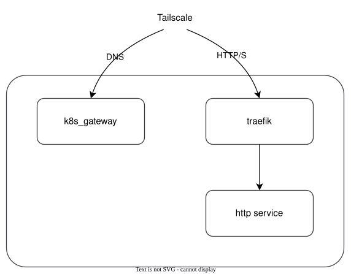

---

GitOps for my Kubernetes cluster defined with [nixidy](https://github.com/arnarg/nixidy).

Applications are written as Nix modules, rendered to plain YAML by nixidy and deployed by [Argo CD](https://argo-cd.readthedocs.io/) from the `main` branch.

## What runs in the cluster

| Application | Purpose |
| --- | --- |
| [Argo CD](https://argo-cd.readthedocs.io/) | Syncs the rendered manifests in `manifests/` to the cluster. |
| [Cilium](https://cilium.io/) | CNI, kube-proxy replacement and network policy enforcement. |
| [Traefik](https://traefik.io/traefik/) | Ingress controller with Let's Encrypt certificates. |
| [tailscale-operator](https://tailscale.com/kb/1236/kubernetes-operator) | Exposes Traefik and k8s_gateway on my tailnet. |
| [k8s_gateway](https://github.com/ori-edge/k8s_gateway) | DNS server resolving Ingress hostnames. |
| [1Password Connect](https://developer.1password.com/docs/k8s/operator/) | Syncs secrets from 1Password into Kubernetes Secrets. |
| [csi-driver-nfs](https://github.com/kubernetes-csi/csi-driver-nfs) | Persistent volumes backed by my NFS server. |
| [Miniflux](https://miniflux.app/) | RSS reader. |
| [Shiori](https://github.com/go-shiori/shiori) | Bookmark manager. |
| `external` | Ingresses for services running outside the cluster. |

## Folder Structure

- `charts/` - Extra Helm Charts (that are not available in [nixhelm](https://github.com/farcaller/nixhelm)) used in the cluster config.
- `manifests/` - Plain YAML Kubernetes manifests generated by nixidy. Argo CD watches these folders for updates. **Never edit these by hand.**
- `modules/` - Nixidy modules that define all the different applications for the cluster. Shared templates live in `modules/templates.nix`.
- `configuration.nix` - Special configuration for the `prod` env (and the only env).
- `flake.nix` - A nix flake setting up the nixidy configuration and helper apps.
- `.github/` - CI workflows and the LLM review script used for automated update PRs.
- `AGENTS.md` - Instructions for AI coding agents working in this repository.

## Usage

All nixidy operations go through the flake so the CLI version matches `flake.lock`:

```sh
# Show the diff between the current config and the committed manifests
nix run .#nixidy -- diff .#prod --path manifests

# Render the manifests into manifests/
nix run .#nixidy -- switch .#prod

# List available resource types and their options
nix run .#nixidy -- resources .#prod

# Lint the Nix code with statix
nix run .#staticCheck

# Update the local charts in charts/
nix run .#updateCharts
```

## Deployment flow

1. Changes to the Nix configuration are pushed to `main`.
2. CI renders the manifests with `nixidy switch` and opens a `promote/env/prod` pull request containing the rendered diff.
3. Once that pull request is merged, Argo CD syncs the new manifests (all applications auto-sync with pruning and self-heal).

Every Saturday a workflow updates the [nixhelm](https://github.com/farcaller/nixhelm) input (and the Cilium CRD source), re-renders the manifests and opens a pull request whose title and description are written by an LLM reviewing the manifest diff.

## Networking

The cluster runs on k3s and uses Cilium for CNI, also replacing kube-proxy.

### Network policies

Cilium runs with `policyEnforcementMode = "always"`, meaning all traffic is denied unless explicitly allowed. Every application ships its own `NetworkPolicy`/`CiliumNetworkPolicy` resources allowing exactly the traffic it needs (ingress from Traefik, access to kube-apiserver, egress to specific FQDNs, etc.).

### Exposing services

Services are only accessible inside my tailscale tailnet. tailscale-operator exposes two services on the tailnet: traefik and k8s_gateway.

[k8s_gateway](https://github.com/ori-edge/k8s_gateway) is a CoreDNS plugin which will resolve the hostname set in Ingresses to the ip or hostname set in `.status.loadBalancer.ingress` of the same `Ingress` object.

[traefik](https://traefik.io/traefik/) proxies all Ingresses and updates their `.status.loadBalancer.ingress` to its own Service's external IP, which is set by tailscale-operator.

With this setup I then just have to set up split DNS in tailscale console to resolve my domain by sending those queries to the address of k8s_gateway. All queries will resolve to traefik's address and it will proxy it forward to the service with the specified hostname in its `Ingress` object.



### TLS

Traefik obtains certificates from Let's Encrypt using the DNS-01 challenge with Cloudflare. This works even though none of the services are publicly reachable. TLS is terminated at Traefik and backends serve plain HTTP.

## Secrets

No secrets are stored in this repository. Secrets live in 1Password and are synced into the cluster by the 1Password Connect operator. Applications request them using the `opSecret` template, which renders a `OnePasswordItem`:

```nix
applications.miniflux.templates.opSecret.miniflux-creds.itemName = "miniflux_creds";
```
